<p align="center">
  
</p>

# COMPTE-RENDU DE TRAVAUX PRATIQUES (TP) : MISE EN PLACE DU PROTOCOLE SSH

| Champ | Détail |
| :--- | :--- |
| **Étudiant** | Ehi Diamhen Winter |
| **Classe** | Licence 3 GLSI (2026-2027) |
| **Matière** | Services Réseaux Avancés |
| **Enseignant** | Dr. GUEYE |

---

## 1. Introduction et Présentation Simple du Travail Réalisé

Le protocole **SSH (Secure Shell)** est un outil indispensable en administration réseau : il permet de prendre le contrôle d'un ordinateur ou d'un serveur à distance en chiffrant toutes les données échangées (mots de passe, commandes et fichiers) pour empêcher toute interception sur le réseau.

### Résumé simple des 4 étapes réalisées dans ce TP :
* **Étape 1 (Installer le serveur SSH) :** Installation et démarrage du service OpenSSH sur notre machine virtuelle Ubuntu afin qu'elle accepte les connexions à distance sur le port 22.
* **Étape 2 (Se connecter à distance) :** Prise de contrôle du serveur Ubuntu via le réseau local depuis l'invite de commandes de notre machine Windows 10.
* **Étape 3 (Connexion sans mot de passe par clés RSA) :** Création d'une paire de clés de sécurité (clé privée + clé publique) sur Windows 10 et envoi de la clé publique sur Ubuntu pour se connecter automatiquement sans saisir de mot de passe.
* **Étape 4 (Tunnels SSH sécurisés HTTP et MariaDB) :** Création de deux tunnels chiffrés pour accéder de manière sécurisée au serveur Web Apache2 (port 1024 vers 80) et à la base de données MariaDB (port 3307 vers 3306) d'Ubuntu depuis Windows 10.

### Architecture réseau mise en place

| Rôle | Machine / Système | Nom d'hôte | Utilisateur | Adresse IP & Services |
| :--- | :--- | :--- | :--- | :--- |
| **Machine Cliente** | Windows 10 Pro (Machine physique) | `DESKTOP-KOLK3MG` | `HP` | `192.168.1.7` — Client SSH, Navigateur Web, MariaDB 13.0 |
| **Machine Serveur** | Ubuntu 26.04.1 LTS (VM VirtualBox en pont) | `winbuntu` | `ehiwinter` | `192.168.1.16/24` (`enp0s3`) — `openssh-server`, `apache2`, `mariadb-server` |

---

## 2. Étape 1 : Installation et vérification du serveur SSH sur Ubuntu

### 2.1. Explication simple du travail effectué
Par défaut, Ubuntu n'accepte pas les connexions SSH entrantes. Nous avons installé le paquet `openssh-server`, activé son lancement automatique au démarrage de la machine, vérifié qu'il fonctionne correctement et qu'il écoute sur le port réseau standard **22**, puis relevé l'adresse IP du serveur Ubuntu.

### 2.2. Commandes exécutées sur le serveur Ubuntu
```bash
# 1. Mettre à jour les paquets et installer le serveur SSH
sudo apt update
sudo apt install openssh-server -y

# 2. Vérifier la version installée et activer SSH au démarrage
apt policy openssh-server
sudo systemctl enable ssh

# 3. Démarrer le service et vérifier son état de fonctionnement
sudo systemctl start ssh
sudo systemctl status ssh

# 4. Vérifier l'ouverture du port 22 et afficher l'adresse IP du serveur
sudo ss -tlnp | grep -w 22
ip a
```

### 2.3. Captures d'écran et interprétation simple

* **Figure 1.1 : Installation du paquet `openssh-server` sur le serveur Ubuntu**  
  *Ce que montre cette capture :* Le terminal télécharge et installe le paquet `openssh-server` ainsi que ses dépendances.  
  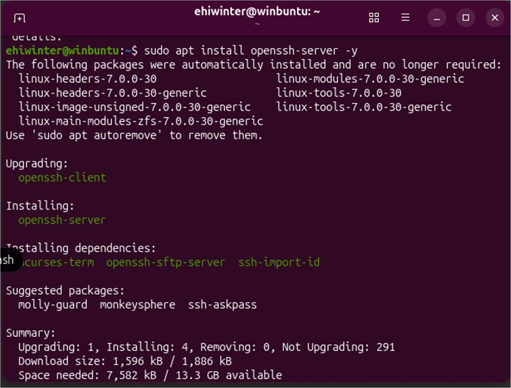

* **Figure 1.2 : Vérification de la version installée (`apt policy`) et activation au démarrage (`systemctl enable ssh`)**  
  *Ce que montre cette capture :* La ligne `Installed: 1:10.2p1-2ubuntu3.8` prouve que SSH est bien installé, et `enable ssh` crée le lien de démarrage automatique.  
  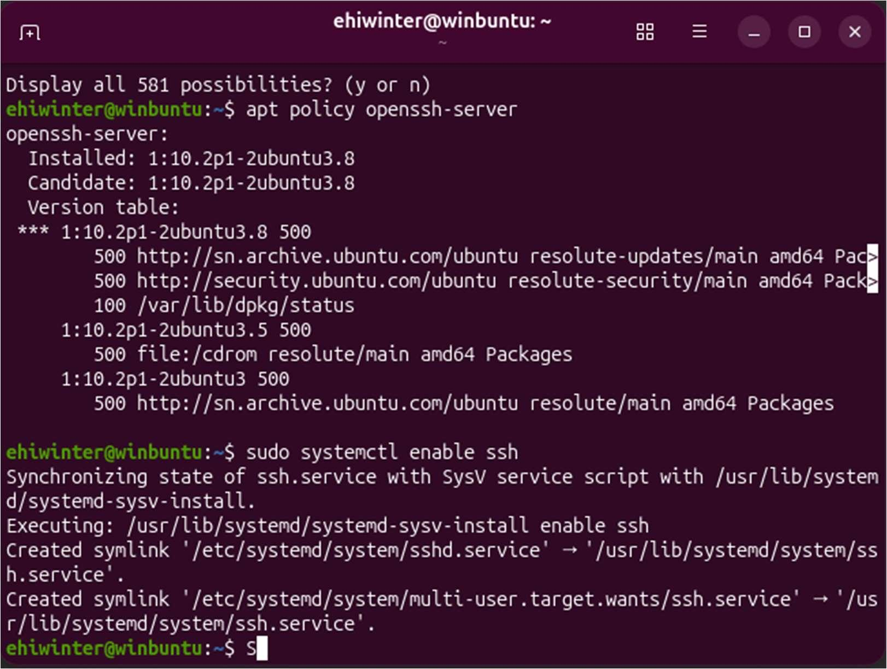

* **Figure 1.3 : Vérification de l'état du service SSH (`sudo systemctl status ssh`)**  
  *Ce que montre cette capture :* L'indication verte `Active: active (running)` confirme que le serveur SSH tourne correctement en arrière-plan.  
  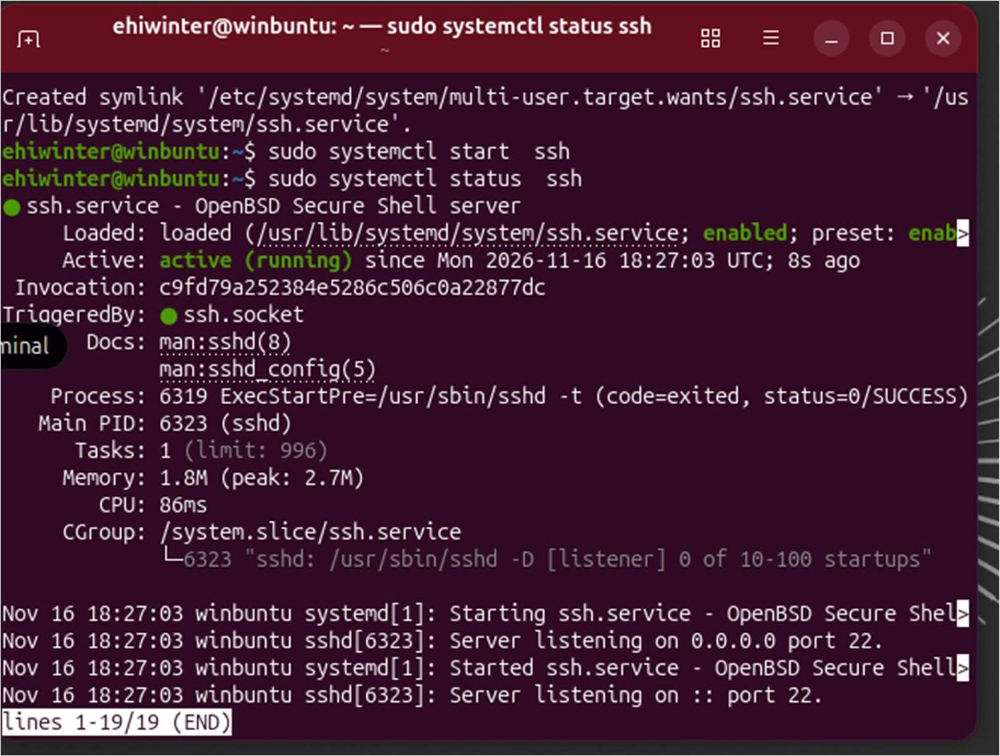

* **Figure 1.4 : Vérification de l'écoute sur le port TCP 22 (`sudo ss -tlnp | grep -w 22`)**  
  *Ce que montre cette capture :* L'état `LISTEN` sur `0.0.0.0:22` et `[::]:22` montre que le port TCP 22 est ouvert et prêt à recevoir des connexions.  
  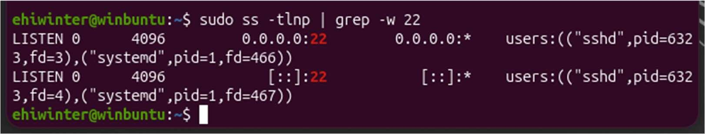

* **Figure 1.5 : Relevé de l'adresse IP de la machine Ubuntu (`ip a`)**  
  *Ce que montre cette capture :* L'interface réseau `enp0s3` du serveur Ubuntu possède l'adresse IP `192.168.1.16` sur le réseau local.  
  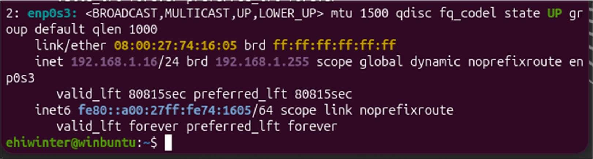

---

## 3. Étape 2 : Connexion SSH à distance depuis le client Windows 10

### 3.1. Explication simple du travail effectué
Depuis l'invite de commandes de notre PC Windows 10, nous nous connectons au serveur Ubuntu (`192.168.1.16`) avec le compte utilisateur `ehiwinter`. Lors de la première connexion, nous acceptons l'empreinte de sécurité `ED25519` en tapant `yes`, puis nous saisissons le mot de passe. Les commandes `hostname` et `whoami` confirment que nous sommes connectés sur `winbuntu`, puis `exit` ferme la session.

### 3.2. Commandes exécutées sur le client Windows 10
```bash
# Se connecter au serveur Ubuntu depuis Windows 10
ssh ehiwinter@192.168.1.16

# Vérifier le nom de la machine et le nom de l'utilisateur distant
hostname
whoami

# Se déconnecter proprement du serveur
exit
```

### 3.3. Captures d'écran et interprétation simple

* **Figure 2.1 : Première connexion SSH depuis Windows 10 vers `ehiwinter@192.168.1.16`**  
  *Ce que montre cette capture :* Après acceptation de l'empreinte de sécurité (`yes`) et saisie du mot de passe, le message `Welcome to Ubuntu 26.04.1 LTS` apparaît dans la fenêtre Windows.  
  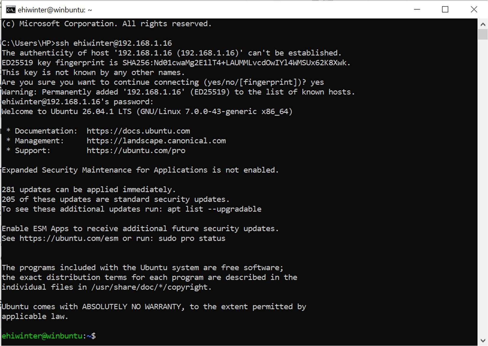

* **Figure 2.2 : Exécution des commandes de vérification (`hostname`, `whoami`) et déconnexion (`exit`)**  
  *Ce que montre cette capture :* La commande `hostname` renvoie `winbuntu` et `whoami` renvoie `ehiwinter`. La commande `exit` ferme la connexion et ramène à `C:\Users\HP>`.  
  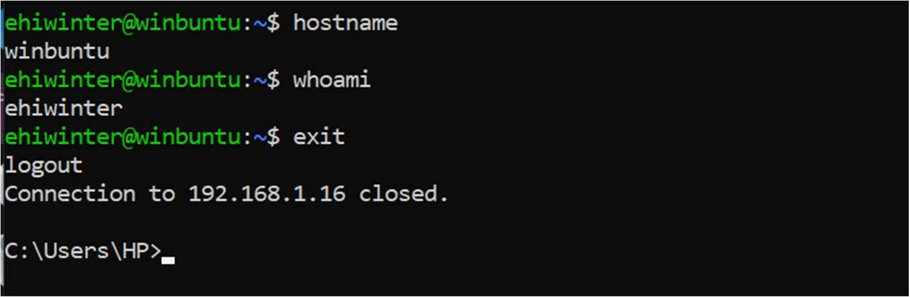

---

## 4. Étape 3 : Authentification par clés SSH (Connexion sans mot de passe)

### 4.1. Explication simple du travail effectué
Pour sécuriser et automatiser la connexion sans saisir de mot de passe à chaque fois, nous utilisons une paire de clés cryptographiques **RSA 3072 bits** :
1. **Création des clés sur Windows (`ssh-keygen`) :** Génération dans le dossier caché `.ssh` d'une clé privée (`id_rsa`, conservée secrètement sur Windows) et d'une clé publique (`id_rsa.pub`).
2. **Envoi de la clé publique au serveur (`scp`) :** Copie du fichier `id_rsa.pub` depuis Windows vers `/home/ehiwinter` sur Ubuntu.
3. **Enregistrement dans `authorized_keys` :** Ajout du contenu de `id_rsa.pub` dans `~/.ssh/authorized_keys` et verrouillage des droits (`chmod 700 ~/.ssh` et `chmod 600 ~/.ssh/authorized_keys`).
4. **Connexion directe :** Windows s'authentifie automatiquement via sa clé privée sans demande de mot de passe.

### 4.2. Commandes exécutées (Client Windows 10 et Serveur Ubuntu)
```bash
# SUR LE CLIENT WINDOWS 10
ssh-keygen -t rsa
dir /a
cd .ssh
dir
scp id_rsa.pub ehiwinter@192.168.1.16:/home/ehiwinter

# SUR LE SERVEUR UBUNTU
ls -la
mkdir -p ~/.ssh
cat ~/id_rsa.pub >> ~/.ssh/authorized_keys
chmod 700 ~/.ssh && chmod 600 ~/.ssh/authorized_keys

# TEST FINAL DEPUIS WINDOWS 10
ssh ehiwinter@192.168.1.16
```

### 4.3. Captures d'écran et interprétation simple

* **Figure 3.1 : Génération de la paire de clés RSA 3072 bits sur Windows 10 (`ssh-keygen -t rsa`)**  
  *Ce que montre cette capture :* Création de la clé privée (`id_rsa`) et de la clé publique (`id_rsa.pub`) sans phrase de passe.  
  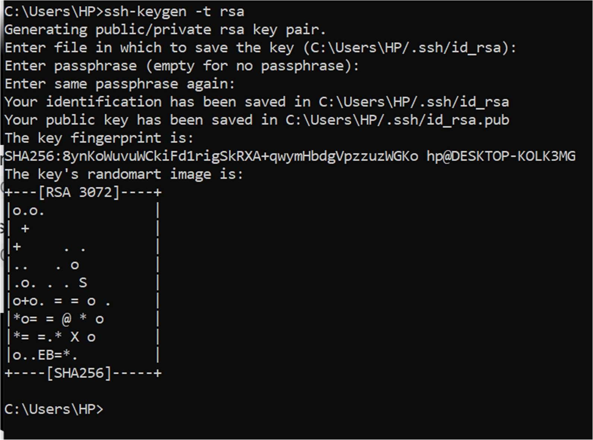

* **Figure 3.2 : Vérification de la création du dossier caché `.ssh` dans `C:\Users\HP` (`dir /a`)**  
  *Ce que montre cette capture :* La commande `dir /a` confirme la présence du répertoire caché `.ssh`.  
  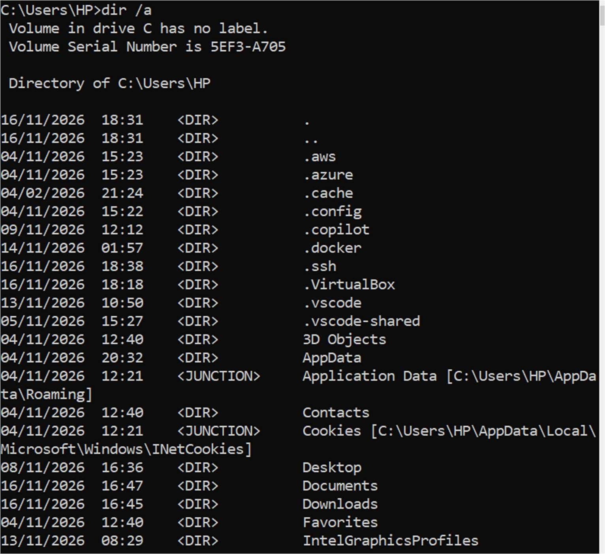

* **Figure 3.3 : Contenu du dossier `.ssh` sur Windows 10**  
  *Ce que montre cette capture :* Présence des deux fichiers générés : `id_rsa` (2 610 octets) et `id_rsa.pub` (573 octets).  
  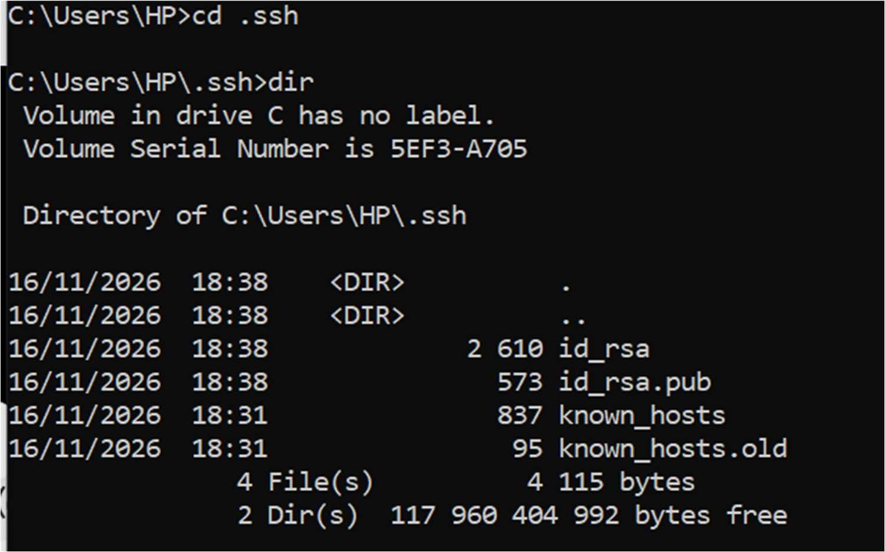

* **Figure 3.4 : Transfert de la clé publique vers le serveur Ubuntu avec SCP**  
  *Ce que montre cette capture :* Le fichier `id_rsa.pub` est transféré à 100 % vers `/home/ehiwinter` sur Ubuntu.  
  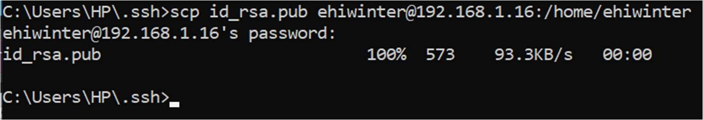

* **Figure 3.5 : Vérification de la présence de `id_rsa.pub` sur le serveur Ubuntu (`ls -la`)**  
  *Ce que montre cette capture :* Le fichier `id_rsa.pub` (573 octets) est bien présent dans le répertoire personnel sur Ubuntu.  
  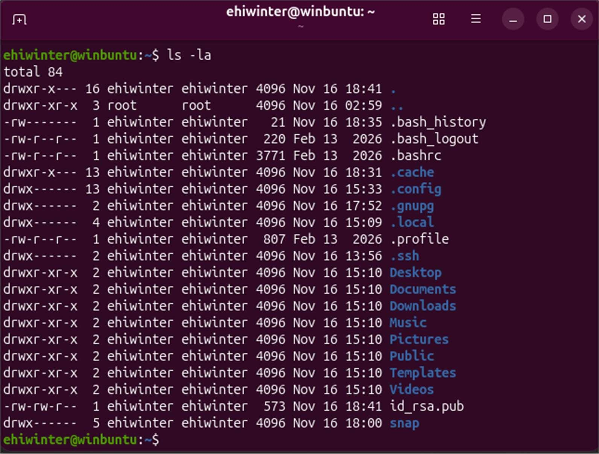

* **Figure 3.6 : Ajout de la clé dans `~/.ssh/authorized_keys` et réglage des permissions (`chmod`)**  
  *Ce que montre cette capture :* La clé publique est enregistrée dans `authorized_keys` et les permissions sont sécurisées (`700` sur `.ssh`, `600` sur `authorized_keys`).  
  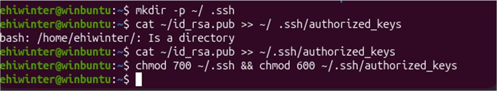

* **Figure 3.7 : Connexion SSH réussie sans aucune demande de mot de passe**  
  *Ce que montre cette capture :* La commande `ssh ehiwinter@192.168.1.16` ouvre directement la session sur Ubuntu sans mot de passe.  
  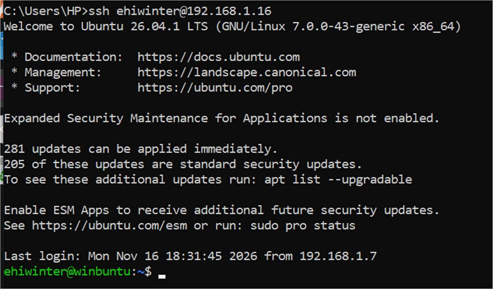

---

## 5. Étape 4 : Tunnels SSH en ligne de commande (HTTP et MariaDB)

### 5.1. Explication simple du travail effectué
Un tunnel SSH (redirection de port local avec l'option `-L`) permet de faire transiter des protocoles classiques (HTTP, SQL) à l'intérieur de la connexion SSH chiffrée :
* **Tunnel 1 — Serveur Web Apache2 (`1024 -> 80`) :** Relie le port `1024` de Windows au port `80` d'Ubuntu afin d'afficher la page Apache2 via `http://localhost:1024`.
* **Tunnel 2 — Base de données MariaDB (`3307 -> 3306`) :** Relie le port `3307` de Windows au port local `127.0.0.1:3306` d'Ubuntu afin d'interroger MariaDB en toute sécurité depuis Windows.

### 5.2. Commandes exécutées (Serveur Ubuntu et Client Windows 10)
```bash
# 1. Sur Ubuntu : démarrer Apache2 et MariaDB et vérifier les ports 80 et 3306
sudo systemctl enable --now apache2 mariadb && sudo ss -tlnp | grep -E '80|3306'

# 2. Sur Ubuntu : créer l'utilisateur SQL 'ehiwinter' pour le test de connexion
sudo mariadb -e "CREATE USER IF NOT EXISTS 'ehiwinter'@'localhost' IDENTIFIED BY 'Passer123'; GRANT ALL PRIVILEGES ON *.* TO 'ehiwinter'@'localhost'; FLUSH PRIVILEGES;"

# 3. Sur Windows 10 : créer le tunnel SSH pour le serveur Web (port local 1024 -> port 80)
ssh -L 1024:127.0.0.1:80 ehiwinter@192.168.1.16

# 4. Sur Windows 10 : créer le tunnel SSH pour MariaDB (port local 3307 -> port 3306)
ssh -L 3307:127.0.0.1:3306 ehiwinter@192.168.1.16

# 5. Sur Windows 10 : se connecter à MariaDB à travers le tunnel (port 3307)
"C:\Program Files\MariaDB 13.0\bin\mariadb.exe" -h 127.0.0.1 -P 3307 -u ehiwinter -p
SHOW DATABASES;
```

### 5.3. Captures d'écran et interprétation simple

* **Figure 4.1 : Activation d'Apache2 et MariaDB sur Ubuntu et écoute sur les ports 80 et 3306**  
  *Ce que montre cette capture :* MariaDB écoute sur `127.0.0.1:3306` et Apache2 écoute sur `*:80`.  
  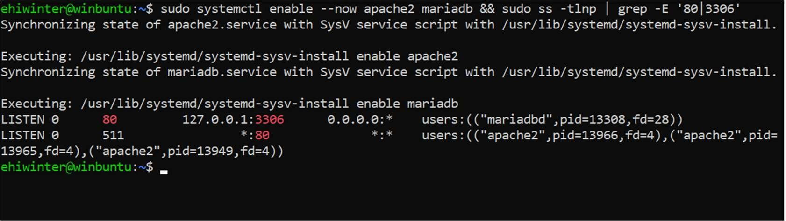

* **Figure 4.2 : Ouverture du tunnel SSH HTTP (port local 1024 vers port 80 d'Ubuntu)**  
  *Ce que montre cette capture :* La commande `ssh -L 1024:127.0.0.1:80 ehiwinter@192.168.1.16` maintient le tunnel chiffré ouvert.  
  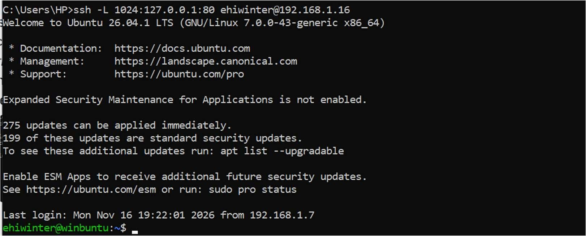

* **Figure 4.3 : Test réussi du tunnel HTTP dans le navigateur Windows (`http://localhost:1024`)**  
  *Ce que montre cette capture :* L'accès à `localhost:1024` dans le navigateur affiche la page `Apache2 Default Page` hébergée sur Ubuntu.  
  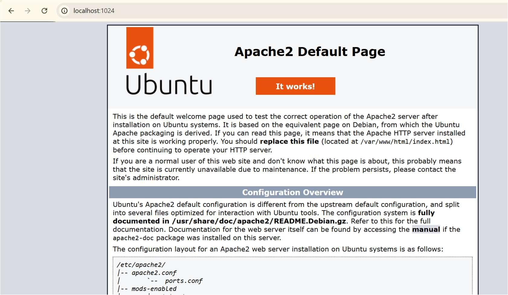

* **Figure 4.4 : Création et autorisation de l'utilisateur SQL `ehiwinter` sur MariaDB (Ubuntu)**  
  *Ce que montre cette capture :* Configuration du compte SQL `ehiwinter@localhost` sur MariaDB.  
  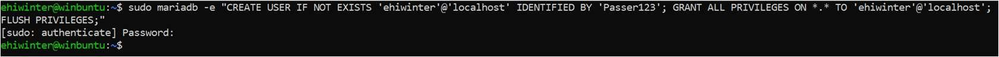

* **Figure 4.5 : Connexion réussie au serveur MariaDB d'Ubuntu depuis Windows 10 via le port 3307**  
  *Ce que montre cette capture :* Le client Windows se connecte sur `127.0.0.1` port `3307` (`Server version: 11.8.6-MariaDB-5ubuntu0.1 from Ubuntu`) et exécute `SHOW DATABASES;`.  
  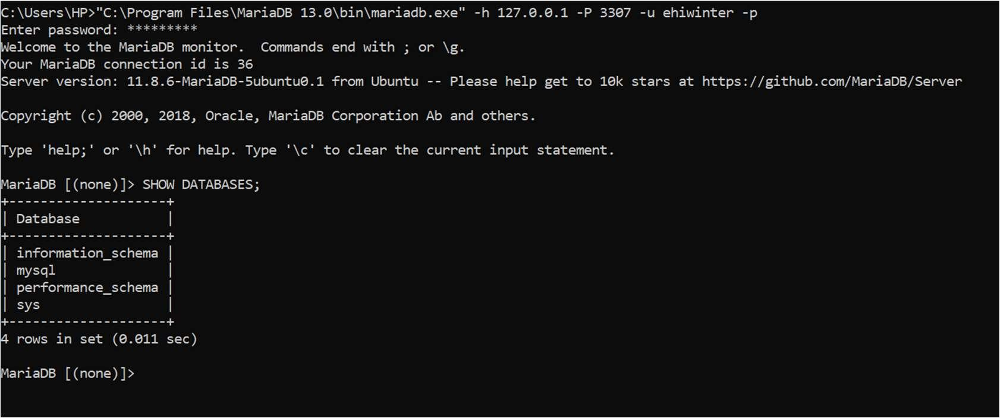

---

## 6. Conclusion Générale

Ce travail pratique nous a permis de mettre en place étape par étape une administration distante complète et sécurisée avec le protocole SSH entre un client Windows 10 et un serveur Ubuntu 26.04 LTS :
1. Installation et vérification du serveur OpenSSH sur le port TCP 22.
2. Validation de la prise de contrôle à distance en ligne de commande.
3. Remplacement du mot de passe par une authentification automatique par clés RSA 3072 bits.
4. Utilisation des tunnels SSH (`ssh -L`) pour accéder de façon chiffrée au serveur Web Apache2 (port 1024) et au serveur de base de données MariaDB (port 3307).
